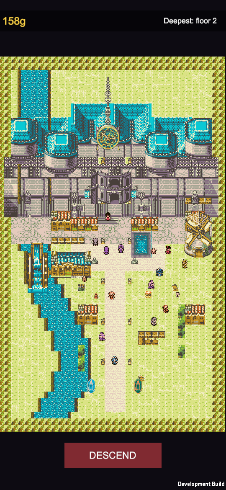

# Depths of the Old

A pixel-art action roguelite for iPhone, built in Unity 6. Explore procedurally generated dungeons, or
survive an endless arena of escalating waves and bosses, in the style of *Vampire Survivors*. It's designed
for one-thumb portrait play.

**C# · Unity 6 (URP 2D) · Python tooling · iOS / Android**

  

> The source code is in a private repository. I'm happy to walk through it or share access for interviews.
> Contact me through my GitHub profile.

## The game

- **Town hub:** spend gold on permanent unlocks, choose your character, then descend.
- **Dungeon mode:** procedural floors to clear, with bosses, health drops and stairs down. A run is one
  continuous life across floors.
- **Survivors mode:** a large open arena where waves never stop. Each boss kill raises the cycle, and enemies,
  bosses and wave sizes scale up multiplicatively, so the run ends only when you die. Your score is how many
  bosses fell.
- **Auto-firing weapons that stack:** up to six fire at once, each with its own range and targeting. Max a
  weapon while holding its partner to evolve both into a stronger weapon.

## Technical highlights

- **The whole game builds from code:** scenes, prefabs, the town layout and all content definitions are
  generated by editor tooling from the raw art. Two batch commands rebuild the project, and a validation step
  checks that every reference resolves before each build.
- **Procedural audio and art tooling:** the music and sound effects are synthesized by my own Python scripts.
  Other scripts compose the castle layout and generate water, shoreline and animated tiles.
- **Built-in automated testing:** launch flags let the game play itself (auto-play, invulnerability, jumping
  to a given floor or wave), and a screenshot mode captures what it renders. That way every change can be
  checked visually, not just by compiling. The screenshot on this page was taken that way.
- **Design decisions grounded in playtesting:** the first version used Archero's stop-to-shoot rule. That made
  the game worse here, because there's no in-run healing and charging enemies converge across open floors, so
  I switched to firing on the move. The design doc records why.
- **Stats that compose correctly:** weapons are multipliers computed on demand, not baked into base stats, so
  upgrades apply consistently to weapons found earlier and later.

## Status

Playable on iOS, with ongoing development. ~11,600 lines of C#.

---

Pixel art: *Adventure Begins* by Zaebucca (licensed, not included in the source repo).
Code, tools and audio © 2026 vaniilla9. All rights reserved.
